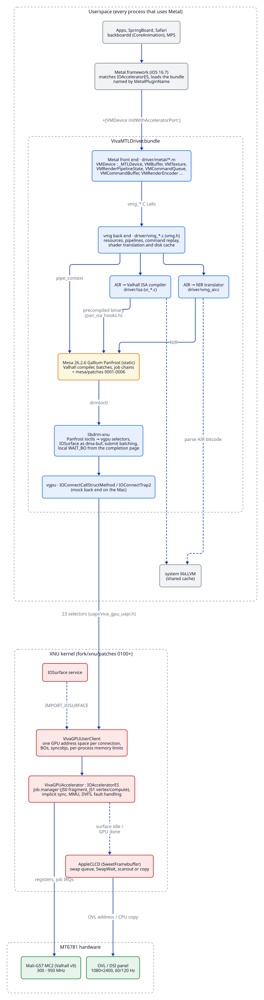
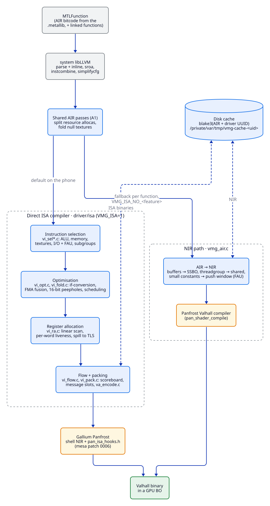
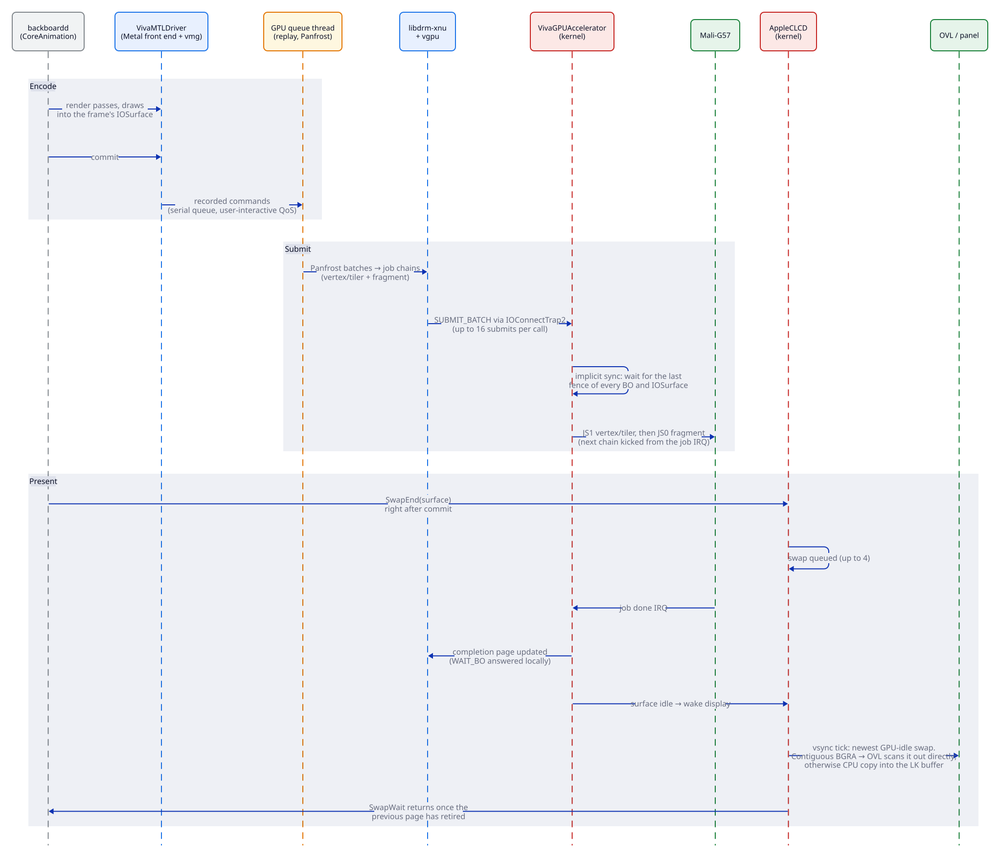
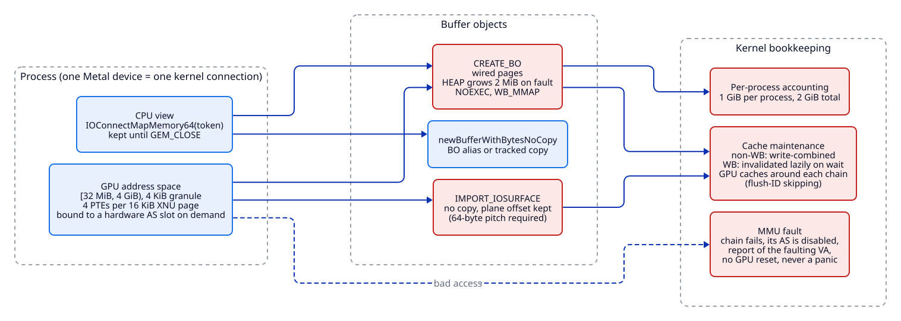

# viva-gpu

**A Metal driver for iOS 16 on the Mali-G57 MC2 (MediaTek Helio G96).**

viva-gpu is the userspace half of the GPU stack of [ios-viva](https://github.com/Nik300/ios-viva), the port of iOS 16.7.16 and XNU to the Redmi Note 11 Pro 4G (`viva`). It is loaded by Apple's own, unmodified `Metal.framework` as a GPU plug-in, just like Apple's AGX drivers on an iPhone. Every Metal client on the phone uses it: CoreAnimation in backboardd, SpringBoard, Safari, MetalPerformanceShaders and the stock apps.

Under the hood it is built on **Mesa's Gallium Panfrost driver**, compiled statically for iOS. Metal shaders arrive as Apple's AIR bitcode. They are translated to NIR for Panfrost's Valhall compiler, or compiled straight to **Valhall machine code by our own AIR → ISA compiler**. Command submission goes through a small libdrm replacement to a purpose-built XNU kernel driver for the Mali job manager.

> **Status (November 2026).** The driver runs on the phone and renders the whole UI. The home screen, Control Center, Settings, Safari, Sileo and third-party apps all draw on the Mali, at 60 or 120 Hz with direct scanout. The UI gets about 37 fps in the heaviest home-screen animation, where the G57's fill rate is the limit (see [Performance](#performance)). It is experimental: some Metal features are missing, and a GPU fault can blank an app (it never takes down the system).

## Contents

- [How it fits together](#how-it-fits-together)
- [Shader compilation](#shader-compilation)
- [Life of a frame](#life-of-a-frame)
- [Memory](#memory)
- [The kernel driver](#the-kernel-driver)
- [Performance](#performance)
- [Feature coverage and known gaps](#feature-coverage-and-known-gaps)
- [Building](#building)
- [Testing](#testing)
- [Installing on the phone](#installing-on-the-phone)
- [Configuration](#configuration)
- [Viva Manager](#viva-manager)
- [Repository layout](#repository-layout)
- [Documentation](#documentation)
- [License](#license)

## How it fits together



**Discovery.** iOS 16's Metal finds GPUs with `IOServiceMatching("IOAcceleratorES")`. The kernel publishes `VivaGPUAccelerator`, a subclass of `IOAcceleratorES`, with `MetalPluginName = VivaMTLDriver` and `MetalPluginClassName = VMDevice`. Metal then loads `/System/Library/Extensions/VivaMTLDriver.bundle` and calls `-[VMDevice initWithAcceleratorPort:]`. From then on the application talks to our classes through the ordinary public Metal API.

**The layers, top to bottom:**

| Layer | Where | What it does |
| --- | --- | --- |
| Metal front end | `driver/metal/*.m` | Subclasses of Metal's private base classes (`_MTLDevice`, `_MTLCommandQueue`, `_MTLRenderCommandEncoder`…): `VMDevice`, `VMBuffer`, `VMTexture`, `VMRenderPipelineState`, `VMCommandBuffer`, `VMRenderEncoder`, `VMComputeEncoder`, `VMBlitEncoder`. Encoders record commands and replay them at commit. The device reports the **Apple3** feature profile; Apple4 would promise tile shading and imageblocks, which Valhall lacks |
| vmg back end | `driver/vmg.h`, `driver/vmg_*.c` | A plain C interface that keeps Mesa out of Objective-C. It handles resources, IOSurface textures, pipelines, the command replay on a serial GPU queue, draw bounds and the shader translation cache |
| Shader compilers | `driver/vmg_air.c`, `driver/isa/` | AIR → NIR, and AIR → Valhall ISA ([below](#shader-compilation)) |
| Mesa | `mesa/` (build script and patches) | Mesa 26.2.6, Gallium Panfrost, linked statically. On iOS only Panfrost is built, without LLVM. Six small patches adapt it to XNU |
| libdrm-xnu | `libdrm-xnu/` | The libdrm calls Panfrost makes, reimplemented on vgpu. Panfrost ioctls become kernel selectors with the same structures, an IOSurface plane stands in for a dma-buf fd, and syncobj snapshots stand in for sync files. It batches submits and answers `WAIT_BO` from a shared completion page without entering the kernel |
| vgpu | `vgpu/` | The kernel connection: `IOConnectCallStructMethod`, or the faster `IOConnectTrap2` path. A **mock back end** emulates the kernel in-process, so the whole stack runs on a Mac |
| UAPI | `uapi/viva_gpu_uapi.h` | The kernel ↔ userspace contract: 23 selectors modelled on `DRM_PANFROST_*` plus a few XNU-specific ones (`IMPORT_IOSURFACE`, `SUBMIT_BATCH`, `SYNCOBJ_TRANSFER`, `SURFACE_PROMISE`). See [`uapi/README.md`](uapi/README.md) |
| Kernel | [ios-viva `xnu/patches/0100`+](https://github.com/Nik300/ios-viva/tree/viva/xnu/patches) | `VivaGPUAccelerator` and `VivaGPUUserClient`: a Valhall job-manager driver written for XNU ([below](#the-kernel-driver)) |

Apple's frameworks are used as they ship. The bundle needs no changes to the shared cache.

## Shader compilation



Metal libraries carry **AIR**, Apple's LLVM-based intermediate representation, not GPU code. `-[_MTLFunction bitcodeData]` hands the bitcode, including linked and private functions, to the driver. The driver parses it with **the system's own libLLVM** from the shared cache, resolved at run time, and cleans it up with LLVM passes (inline, SROA, instcombine, simplifycfg). From there, two compilers are available.

**AIR → NIR → Panfrost** (`driver/vmg_air.c`). The translator maps Metal's model onto NIR: buffers become SSBOs, threadgroup memory becomes shared memory, private arrays become scratch, and small `constant` buffers are pushed into the uniform window that Valhall reads as FAU. Panfrost's Valhall compiler then does the rest. This path is complete and always available.

**AIR → Valhall ISA** (`driver/isa/`, enabled with `VMG_ISA=1`, the setting used on the phone). This is a compiler written for this project. It goes from LLVM IR straight to Valhall v9 machine code, with no NIR in between:

1. **Selection** (`vi_sel*.c`): ALU, memory, textures, I/O with FAU and system values, subgroup operations and derivatives, all as machine IR on a CFG in reverse post-order.
2. **Optimisation** (`vi_opt.c`, `vi_fold.c`): if-conversion, block merging, copy propagation and DCE per 32-bit word, FMA fusion, constant folding, 16-bit lane peepholes, scheduling, sinking and coalescing.
3. **Register allocation** (`vi_ra.c`): linear scan with liveness per 32-bit word; it spills to thread-local storage.
4. **Flow and packing** (`vi_flow.c`, `vi_pack.c`): message slots, scoreboard waits, ATEST / BLEND / BARRIER, discard, the blend prologue, branch offsets and the final encoding. The encoder (`va_encode.c`) uses tables generated from Arm's v9 ISA description (`gen_va_v9.py`: 366 instructions, every field range-checked).

The finished binary enters Gallium as a "shell" NIR shader that only has stage and I/O information. Mesa patch 0006 adds `pan_isa_hooks.h`, through which Panfrost picks up our binary, shader info and varying layout instead of compiling. Each compiler feature has an ID (A1…G4). `VMG_ISA_NO_<ID>` sends one feature back to NIR, and any function the ISA compiler cannot handle falls back to NIR automatically. Viva Manager can apply a phone-verified selection (`app/Resources/isa-verified.json`).

Why a second compiler? Valhall is compute-bound on CoreAnimation's shaders, so instruction count is frame time. After its optimisation pass, the ISA path matches Mesa's code (1.19× Mesa's instruction count on a corpus of real CoreAnimation shaders, home swipe 27.2 ms vs 26.8 ms). It also compiles without NIR, and its binaries are cached on disk.

**Caching.** NIR translations and ISA binaries go to a disk cache keyed by a BLAKE3 hash of the AIR and the driver build's UUID (`/private/var/tmp/vmg-cache-<uid>` on the phone, `~/.cache/vmg` on the Mac). Mesa's own shader cache is off in the iOS build, so the NIR path recompiles Valhall code at each launch. The ISA path does not.

## Life of a frame



1. **Encode.** CoreAnimation, in backboardd, encodes render passes into the frame's IOSurface. Encoders only record. At `commit`, the command buffer is replayed on the device's serial GPU queue (user-interactive QoS) as `vmg_cmd_*` calls, which Panfrost turns into batches and Valhall job chains (vertex/tiler, then fragment).
2. **Submit.** libdrm-xnu queues the submits and sends up to 16 per `SUBMIT_BATCH` trap. Command buffers that write an IOSurface are submitted before `commit` returns, so the display never waits on a queue that has not started.
3. **Schedule.** The kernel keeps a FIFO per connection and per job slot: JS1 for vertex, tiler and compute, JS0 for fragment. **Implicit sync** makes every job wait for the last fence of each BO and IOSurface it uses, across processes, so producers and consumers order themselves without explicit fences. When a chain completes, the job IRQ starts the next one immediately ("fast kick").
4. **Complete.** The job IRQ updates a completion page mapped into every client, so most waits finish in userspace. Fences are binary syncobjs, moved between owners with `SYNCOBJ_TRANSFER` (Mesa patch 0005).
5. **Present.** CoreAnimation calls `SwapEnd` right after committing. The display driver (`AppleCLCD`) queues up to four swaps. On each vsync tick it shows the newest swap whose surfaces the GPU has finished. A GPU completion wakes it early, and a frame still unfinished after 12 ticks is shown anyway.
6. **Scanout.** A full-screen BGRA surface that is physically contiguous is **scanned out directly**: the overlay engine is repointed at it, with no copy. A contiguous page pool reserved at boot makes that the common case. Anything else is copied by the CPU into the bootloader's framebuffer (about 3 ms per frame). `SwapWait` blocks CoreAnimation until the page it is about to reuse has left the screen.

When the display finds a frame still unfinished on the GPU, the kernel's GPU governor jumps to its top clock. Frames and touches also boost the CPU governor (see [ios-viva → DVFS](https://github.com/Nik300/ios-viva/tree/viva#dvfs-cpu-and-gpu-clocks-under-load)).

## Memory



- **Address spaces.** Every kernel connection, which means every Metal device in every process, gets its own GPU page table: AArch64 format, 4 KiB granule, VAs in [32 MiB, 4 GiB) as Mesa expects. XNU uses 16 KiB pages, so each one is four GPU PTEs. Address spaces are bound to the GPU's hardware AS slots on demand, LRU.
- **Buffer objects** are wired kernel memory, mapped into the process with `IOConnectMapMemory64`. Flags as in Panfrost: `HEAP` (the tiler heap grows 2 MiB at a time on translation faults), `NOEXEC`, `WB_MMAP`.
- **Coherency.** The MT6781's GPU is not IO-coherent. Buffers without `WB_MMAP` are mapped write-combined. Cached buffers are invalidated lazily, only when userspace waits on them. GPU caches are flushed around each chain, skipped when a flush ID shows the work was already done. All of this is the kernel's job: userspace never issues cache maintenance.
- **IOSurfaces** are imported without copying (`IMPORT_IOSURFACE`): the BO covers the plane's pages, and the GPU address points at the plane's first byte. Pitches must be 64-byte aligned; others go through a CPU copy.
- **`newBufferWithBytesNoCopy`** aliases a BO when alignment allows. Otherwise it uses a shared copy tracked by hash or generation.
- **Limits.** GPU memory is accounted per process (1 GiB per process, 2 GiB total by default). A process past the limit gets `kIOReturnNoMemory`, not a system-wide shortage.
- **Faults** are contained. An MMU fault fails the chain and disables that address space, and the kernel logs which BO, freed range or unmapped area the address hit. There is no GPU reset and never a panic: the app's frame is lost, and the rest of the system keeps running.

## The kernel driver

The kernel side lives in the ios-viva patch series (`0100-viva-gpu-mali` onward, `iokit/Kernel/arm/VivaGPU.cpp`). It is a Valhall job-manager driver written from the register map. The MFG power-up sequences and values come from Xiaomi's published Linux sources.

| Area | Behaviour |
| --- | --- |
| Power | MFG power domains and clocks, MT6366 VGPU / VSRAM_GPU rails, powered at boot with `vivagpu=2` |
| DVFS | 49 OPPs, 300–950 MHz. The governor samples load every 50 ms, jumps to the top OPP above 85 % busy or when the display waits for a frame, and otherwise settles at the slowest OPP that would be ≤ 70 % busy. Rails move in 50 mV steps while jobs run |
| Scheduling | Per-connection queues per job slot, implicit sync across processes (including IOSurfaces), a dependency walk that keeps cross-process promises deadlock-free, fast kick from the IRQ |
| Robustness | Chains over 3 s are hard-stopped, a slot that ignores the stop resets the GPU, MMU faults are contained (above). Timeouts follow userspace's `CLOCK_MONOTONIC` |
| Observability | `kern.viva_link` sysctl and the USB link: `gpu status`, `gpu freq`, `gpu dvfs`, `gpu lat`, `gpu kv` (load, MHz, jobs, faults, memory per process…). Each process's driver also publishes live counters in a shared page (`/private/var/tmp/vmg-stats/<pid>`) |

## Performance

Measured on the phone (Mali-G57 MC2 at up to 950 MHz, ISA compiler, direct scanout), November 2026:

| Scenario | Result |
| --- | --- |
| Home-screen swipe (wallpaper, icons, blur) | 26.4–27.5 ms per frame, **~37 fps**. GPU 90–93 % busy, 24 jobs per frame |
| Same, first driver version (2026-11-03) | ~120 ms per frame, before NoCopy-buffer tracking, constant push and scanout |
| Settings scroll | 42.9 ms → **19.9 ms per frame** once the CPU governor learned to boost on UI activity |
| Fill rate (`passbench`) | 3.4 Gpx/s measured, 3.8 Gpx/s theoretical. A full-screen blended layer costs ~0.8 ms |
| ISA vs NIR compiler | home swipe 36.5 → 27.2 ms after the ISA optimisation pass, Mesa's NIR path 26.8 ms |

The home screen is bound by the G57's fill rate: about 30 full-screen equivalents of blended pixels per frame put the hardware ceiling near 45–48 fps on that scene. Lighter screens and app scrolling are latency- and CPU-bound instead, which is what the display pipeline and DVFS work targets. Detailed analysis: [`docs/ANALISI-PRESTAZIONI-2026-11-06.md`](docs/ANALISI-PRESTAZIONI-2026-11-06.md).

## Feature coverage and known gaps

Shader coverage on iOS 16.7's system libraries:

| Library | NIR path | ISA path |
| --- | --- | --- |
| QuartzCore (CoreAnimation) | 137/141 | **141/141** |
| RenderBox (SwiftUI) | — | **47/47** |
| MetalPerformanceShaders kernels | 872/879 | 832/879 |
| `isatest` cases on the phone | 74/89 | **83/89** (the 6 failures also fail on NIR) |

Supported: render and compute pipelines, vertex descriptors, MSAA, depth/stencil, blending, all common texture types and formats (including IOSurface-backed and buffer textures), threadgroup memory, atomics, image writes, non-uniform grids, subgroups and derivatives, half precision, linked functions, and argument buffers containing plain pointers.

Not yet:

- Argument buffers containing textures or samplers, and indirect command buffers.
- Imageblocks / tile shading. The device advertises Apple3 for this reason; a compute-based emulation exists but is not complete on hardware.
- `clip_distance`, `min_lod_clamp`, some cube-as-array / depth reads, and select/phi between textures.
- Performance counters, and the Mesa shader cache on iOS.
- XR10 wide-colour formats are converted, not native.

## Building

Everything builds on macOS. The Mac build uses the Command Line Tools; the phone build needs Xcode's iOS SDK.

```sh
# Mac: Mesa (llvmpipe + Panfrost), libdrm-xnu, the driver and its tests
bash mesa/build.sh macos              # clones Mesa 26.2.6 into mesa/src, applies mesa/patches
make -C vgpu test                     # UAPI contract against the mock kernel
make -C driver all metal test

# Phone: VivaMTLDriver.bundle + test binaries (needs Xcode)
ios/build.sh                          # all | mesa | driver | tests  ->  ios/out/
```

GitHub Actions does the same (`.github/workflows/build.yml`, macOS runner, ccache and per-section caches): Mesa for macOS, the Mac tests, Mesa for iOS, the bundle, and the phone tests, each uploaded as an artifact (`viva-gpu-ios` for the phone). `app.yml` builds Viva Manager.

## Testing

The mock vgpu back end and llvmpipe let the whole driver run on a Mac against real Metal code:

| Suite | What | llvmpipe |
| --- | --- | --- |
| `vgpu/test_vgpu` | UAPI contract against the mock | 28/28 |
| `phase1` | device, buffers, textures, heaps | 44/44 |
| `phase3` | render: pipelines, varyings, depth, textures, blending, MSAA | 33/33 |
| `translate` | AIR translator on real shaders | 24/24 |
| `uploads` | CPU/GPU coherency | 20/20 |
| `compute` | threadgroups, atomics, image writes, non-uniform grids | 10/10 |
| `ca` | QuartzCore's `CARenderer` composites a layer tree (rounded corners, shadow, text, gradient, 3D, blur) | pixel-identical to an Apple M1 |

With `VMG_DRIVER=panfrost VGPU_BACKEND=mock` the same suites run Panfrost and our compilers on the Mac. Nothing executes on a GPU there, but every job chain is built and can be decoded with `pandecode` (`PAN_MESA_DEBUG=trace`).

On the phone:

- `isatest` checks every ISA feature against NIR and the CPU, case by case.
- `passbench` measures fill rate and pass costs, `mpstest` runs MPS kernels and `bounds` exercises the draw-bounds code.
- `vctl` drives the UI (tap, swipe, home, open an app, screenshots).
- `airnir` (Mac) dumps the NIR or ISA for any `.metal`, `.metallib` or captured `.vair` shader. Set `VMG_DUMP_AIR=DIR` on the phone to capture a process's shaders.

## Installing on the phone

You need a phone running [ios-viva](https://github.com/Nik300/ios-viva) with the GPU kernel driver (`vivagpu=2` in the boot-args) and the USB link.

1. Build or download the `viva-gpu-ios` artifact.
2. Push `VivaMTLDriver` (mode 755) and `_CodeSignature/CodeResources` to `/System/Library/Extensions/VivaMTLDriver.bundle/`, and the test binaries to `/private/var/root/viva-tests/`.
3. New processes pick the driver up immediately. backboardd and SpringBoard need a restart (Viva Manager can do it) or a reboot.

## Configuration

The driver reads its settings from the environment or from `VivaMTLDriver.bundle/vmg.env` (`KEY=VALUE`, `#` comments). The file is how system daemons like backboardd are configured. The most useful settings:

| Variable | Effect |
| --- | --- |
| `VMG_ISA=1` | use the direct ISA compiler (falls back to NIR per function) |
| `VMG_ISA_NO_<ID>`, `VMG_ISA_ONLY=…`, `VMG_ISA_STRICT=1` | per-feature control of the ISA compiler |
| `VMG_CACHE_DIR`, `VMG_NO_AIR_CACHE=1` | shader cache location / off |
| `VMG_DRIVER=panfrost\|llvmpipe`, `VGPU_BACKEND=iokit\|mock` | back end selection (Mac testing) |
| `VMG_TRACE=1`, `VMG_TRACE_NIR=1`, `VMG_TRACE_ISA=1`, `VMG_TRACE_FRAME=MS`, `VGPU_TRACE_BO=1`, `TSMTL_LOG=1` | tracing |
| `VMG_DUMP_AIR=DIR` | save every shader the process compiles |
| `VMG_HALF32=1` | treat `half` as 32-bit float |
| `VMG_NO_DRAW_BOUNDS=1`, `VMG_NO_CLEAR_DRAW=1` | disable the draw-bounds scissor / clear-draw folding |
| `VGPU_NO_SUBMIT_BATCH=1`, `VGPU_NO_TRAP=1`, `VGPU_NO_LOCAL_WAIT=1` | fall back to one kernel call per operation |

Kernel boot-args (set from Viva Manager or `kern.viva_nextbootargs`): `vivagpu` (0 off, 2 on), `vivagpufreq` / `vivagpufreqmax` (DVFS range, MHz), `vivagpudvfs`, `vivagpuboost`, `vivagpumem` / `vivagpumemtotal` (MiB), `vivagpucache`, `vivascanout`, `vivafbpool`, `vivapanelhz` (60, 120 or 1 = auto).

## Viva Manager

`app/` is an iOS app for the phone that manages all of the above without a computer:

- **MaliMetal**: driver flags with descriptions (written to `vmg.env`), the ISA compiler page with its on-device test panel, and accelerator settings.
- **Boot Args**: next boot's arguments.
- **Display**: 60 / 120 Hz / auto.
- **Stats**: CPU, RAM and GPU (frequency, DVFS, jobs, faults, memory), plus per-process Metal statistics (command buffers, draws, latencies, GPU time, cache hits) from the driver's shared pages.
- **SpringBoard** and **Dynamic Island** settings.

It builds in CI (`app.yml`) or with `app/build.sh`, and installs with `app/install.sh` over the USB link. See [`app/README.md`](app/README.md).

## Repository layout

| Path | What |
| --- | --- |
| `driver/metal/` | Metal front end (Objective-C) |
| `driver/` | vmg back end, AIR → NIR translator, tests (`tests/`) and tools (`tools/airnir`) |
| `driver/isa/` | AIR → Valhall ISA compiler and encoder |
| `mesa/` | Mesa build script, cross files and patches (the Mesa tree itself is cloned at build time) |
| `libdrm-xnu/` | libdrm on top of vgpu |
| `vgpu/` | kernel client: IOKit and mock back ends |
| `uapi/` | kernel ↔ userspace contract and its specification |
| `ios/` | phone build, bundle Info.plist, `vctl` |
| `app/` | Viva Manager app, helper and SpringBoard tweaks |
| `shim/` | metal-shim, the project's OpenGL-backed origin, kept as reference and for its test suites |
| `docs/` | design notes and analyses (Italian), diagrams (`docs/diagrams/*.d2`) |

## Documentation

The design documents in `docs/` are in Italian:

| Document | Topic |
| --- | --- |
| [`ISA-COMPILATORE.md`](docs/ISA-COMPILATORE.md), [`ISA-ABI-V9.md`](docs/ISA-ABI-V9.md) | the ISA compiler: features, toggles, results; Valhall v9 ABI |
| [`ANALISI-PRESTAZIONI-2026-11-06.md`](docs/ANALISI-PRESTAZIONI-2026-11-06.md) | where frame time goes, and the plan that followed |
| [`ANALISI-SCANOUT-RE.md`](docs/ANALISI-SCANOUT-RE.md), [`ANALISI-KERNEL-RENDERING.md`](docs/ANALISI-KERNEL-RENDERING.md) | reverse engineering of IOMobileFramebuffer's swap protocol; kernel rendering path |
| [`FINDINGS-2026-11-03.md`](docs/FINDINGS-2026-11-03.md) | first light on the phone, procedures, debugging notes |
| [`RICHIESTE-KERNEL.md`](docs/RICHIESTE-KERNEL.md) | what userspace asked of the kernel, and why |
| [`PIANO-DISPLAY-NATIVO.md`](docs/PIANO-DISPLAY-NATIVO.md), [`DYNAMIC-ISLAND.md`](docs/DYNAMIC-ISLAND.md) | native 1080×2400 layout, Dynamic Island |
| `ABI-*.md`, `MDP-MT6781.md`, `JPGENC-MT6781.md` | hardware accelerators (scaler, JPEG) behind Apple's accelerator APIs |

The diagrams in this README are written in [D2](https://d2lang.com) (`docs/diagrams/`) and rendered to SVG with [Kroki](https://kroki.io):

```sh
curl -X POST https://kroki.io/d2/svg -H 'Content-Type: text/plain' --data-binary @docs/diagrams/frame.d2 -o docs/frame.svg
```

## License

viva-gpu is free software, released under the **GNU General Public License v3.0 or later** ([`LICENSE`](LICENSE)). It comes with an additional term under section 7(b) of the GPL: **redistributions and derivative works must keep the author attribution and the credits in [`NOTICE`](NOTICE)** and show them in their documentation or "about" screen.

Third-party components keep their own licenses: Mesa and its patches (MIT), the libdrm and DRM UAPI headers in `libdrm-xnu/include` (MIT), and tables derived from Arm's Valhall ISA description (MIT). See [`NOTICE`](NOTICE) for details. Metal, iOS and every Apple framework the driver plugs into belong to Apple and are not part of this repository.

## Credits

- [Mesa](https://mesa3d.org) and the Panfrost developers at Collabora and in the community, whose Gallium driver and Valhall compiler do much of the heavy lifting.
- Arm, for the Valhall ISA description shipped in Mesa.
- Xiaomi's published kernel sources for the MT6781's GPU power sequences.
- [ios-sweet](https://github.com/dipa-studio/ios-sweet), the XNU port that ios-viva builds on.
